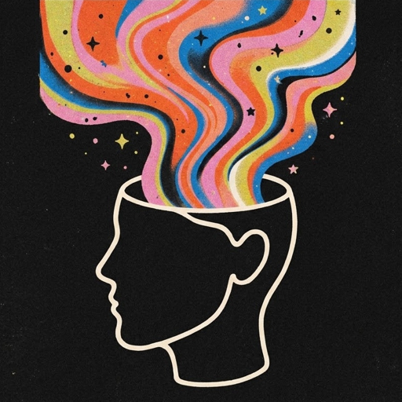

<div align="center">
  
  <h1>SONDER</h1>
  <p><strong>VS Code Theme & Icon Collection</strong></p>
  <p><em>“Every theme has a character of its own.”</em></p>
</div>

---

A thoughtfully curated collection of **22 dark and light themes** and **22 matching themed file icon sets** for Visual Studio Code across **11 distinct color families**. Minimal, design-focused, and refined for extended daily coding sessions.

**Zero configuration required:** Choose any SONDER color theme, and the matching file icon theme is applied automatically.

---

## ✦ The Collection & Automatic Icon Mapping

When you select a SONDER color theme, SONDER automatically activates its matching icon theme. You never need to manually configure file icons.

| Family           | SONDER Color Theme                                    | Automatically Applied Icon Theme                              | Appearance                                                         |
| ---------------- | ----------------------------------------------------- | ------------------------------------------------------------- | ------------------------------------------------------------------ |
| **01. Abyss**    | `SONDER — Abyss Dark`<br>`SONDER — Abyss Light`       | `SONDER Abyss Icons Dark`<br>`SONDER Abyss Icons Light`       | Oceanic cyan & deep slate<br>Clean crisp teal on paper             |
| **02. Nocturne** | `SONDER — Nocturne Dark`<br>`SONDER — Nocturne Light` | `SONDER Nocturne Icons Dark`<br>`SONDER Nocturne Icons Light` | Ethereal violet & magenta<br>Rich royal purple on mist             |
| **03. Sakura**   | `SONDER — Sakura Dark`<br>`SONDER — Sakura Light`     | `SONDER Sakura Icons Dark`<br>`SONDER Sakura Icons Light`     | Soft petal rose & crimson<br>Deep ruby rose on porcelain           |
| **04. Umber**    | `SONDER — Umber Dark`<br>`SONDER — Umber Light`       | `SONDER Umber Icons Dark`<br>`SONDER Umber Icons Light`       | Warm terracotta & amber<br>Grounded clay & sepia                   |
| **05. Midnight** | `SONDER — Midnight Dark`<br>`SONDER — Midnight Light` | `SONDER Midnight Icons Dark`<br>`SONDER Midnight Icons Light` | Electric sky & nocturnal blue<br>Deep sapphire on canvas           |
| **06. Forest**   | `SONDER — Forest Dark`<br>`SONDER — Forest Light`     | `SONDER Forest Icons Dark`<br>`SONDER Forest Icons Light`     | Luminous emerald & moss<br>Deep forest botanical green             |
| **07. Nebula**   | `SONDER — Nebula Dark`<br>`SONDER — Nebula Light`     | `SONDER Nebula Icons Dark`<br>`SONDER Nebula Icons Light`     | Atmospheric neon magenta & violet<br>Vibrant ultraviolet on frost  |
| **08. Ocean**    | `SONDER — Ocean Dark`<br>`SONDER — Ocean Light`       | `SONDER Ocean Icons Dark`<br>`SONDER Ocean Icons Light`       | Vivid cyan & marine turquoise<br>Deep marine cobalt on mist        |
| **09. Ember**    | `SONDER — Ember Dark`<br>`SONDER — Ember Light`       | `SONDER Ember Icons Dark`<br>`SONDER Ember Icons Light`       | Warm blaze orange & gold<br>Deep burnt sienna & terracotta         |
| **10. Lavender** | `SONDER — Lavender Dark`<br>`SONDER — Lavender Light` | `SONDER Lavender Icons Dark`<br>`SONDER Lavender Icons Light` | Gentle periwinkle & lilac<br>Deep royal violet on parchment        |
| **11. Blossom**  | `SONDER — Blossom Dark`<br>`SONDER — Blossom Light`   | `SONDER Blossom Icons Dark`<br>`SONDER Blossom Icons Light`   | Playful blossom pink & raspberry<br>Deep fuchsia wine on porcelain |

---

## 🎨 Complete Visual Ecosystem

```
SONDER Color Theme
        ↓
 ┌──────┼─────────┐
 ↓      ↓         ↓
Surfaces Accent  Syntax
        ↓
   ┌────┼─────┐
   ↓    ↓     ↓
Cursor Tabs Selection
        ↓
   Icon Theme
        ↓
Matching SONDER file icons
```

### 1. Themed File Icon Themes (Pierre Geometry)

- **Minimalist & Geometric:** Built upon the clean vector geometry of Pierre Icons (`vscode-icons`), engineered on a crisp `16x16` pixel grid for razor-sharp legibility at standard sidebar scales.
- **Harmonically Themed:** Unlike traditional rainbow icon sets, SONDER file icons are strictly themed to match each palette family's chromatic DNA.
- **22 Dedicated Icon Themes:** 11 families × 2 variants (Dark & Light) = 22 standalone icon themes registered directly in `package.json`.
- **Dark Icon Themes:** Luminous, high-energy accents that pop cleanly against dark sidebar surfaces.
- **Light Icon Themes:** Deliberately adjusted darker, stronger variants of the family colors to ensure clear contrast and zero eye fatigue against light sidebar canvases.
- **Semantic Hierarchy:**
  - **Primary:** Flagship family accent for core language files (TypeScript, Rust, React, Python, Go, etc.).
  - **Secondary:** Complementary accent for web standards and scripts (JavaScript, HTML, CSS, Shell).
  - **Muted Neutral:** Subtle base tone for documentation, markdown, and generic files.
  - **Themed Folders:** Closed and open folder states with distinct badges for `src`, `components`, `pages`, `app`, `test`, `docs`, `config`, `api`, `lib`, and `assets`.

### 2. Automatic Color Theme → Icon Theme Synchronization

- **One-Click Experience:** Select `Preferences: Color Theme` → `SONDER — Ember Dark`, and your file icons immediately switch to `SONDER Ember Icons Dark`.
- **Intelligent Non-SONDER Protection:** When you switch to a third-party or built-in theme (such as _Default Dark Modern_, _GitHub Dark_, or _Dracula_), SONDER immediately restores your previous non-SONDER icon theme and halts automatic icon switching.
- **One-Way Direction & Anti-Looping:** The color theme is always the single source of truth. SONDER never alters your color theme when an icon theme is changed.
- **User Controllable:** Toggle anytime via the setting `sonder.autoMatchIconTheme: true` (or Command Palette: `SONDER: Toggle Automatic Icon Theme Matching`).

### 3. Subtle Themed Folder Highlights (Explorer Badges)

- **Native & Cross-Platform:** Implemented 100% natively via the official `vscode.FileDecorationProvider` API.
- **Zero Hacks:** Works identically across macOS, Linux, and Windows with zero filesystem patching, zero security warnings, and zero performance impact.
- **Subtle Identification:** Prominent folders like `src`, `components`, `app`, `test`, `docs`, and `config` receive subtle badges and theme-derived accents in the file explorer.
- **Toggle Anytime:** `Cmd+Shift+P` → `SONDER: Toggle Themed Folder Highlights`.

### 4. Adaptive Theme Surface System

- **Dark Themes:** The deepest tone (`palette.darkest`) becomes the primary `editor.background`. The sidebar takes the second-darkest tone (`palette.deep`), and the panel/status bar forms the third-darkest supporting layer (`palette.surface`).
- **Light Themes:** Clean, glare-free canvas tones (`palette.lightest`) anchor the editor, while the sidebar and panels gently deepen in value.
- **Dynamic Theme-Aware Tabs:** Active tabs receive a subtle chromatic tint derived from the active theme's accent (`theme.accent`), bordered with an elegant accent indicator (`tab.activeBorderTop`).

### 5. Subtle Neovide-Inspired Cursor Motion

- **Smooth Caret Glide:** When moving through code, the cursor smoothly springs and glides toward its new position with micro-motion easing rather than instantly teleporting.
- **Theme-Synchronized Glow:** Cursor and glide trail colors dynamically match the active SONDER theme's semantic accent.
- **100% Native & Safe:** Built exclusively using official VS Code APIs (`TextEditor.setDecorations`). Zero CSS injection, no Custom CSS/JS Loader, and zero file modification.

---

## 💻 Comprehensive Language & File Support

Extensively tested across contemporary languages, runtimes, and frameworks:

- **TypeScript & JavaScript** (including React JSX/TSX)
- **HTML, XML, SVG**
- **CSS, SCSS, LESS**
- **Python** (type hints, decorators, f-strings)
- **Rust, Go, Java, Kotlin, C/C++, C#, PHP, Ruby, Swift**
- **JSON & JSONC, YAML, TOML**
- **Markdown, Dockerfile, Git, Shell scripts**
- **Vue, Svelte, GraphQL**

---

### Abyss

| Dark                                                                                                    | Light                                                                                                     |
| ------------------------------------------------------------------------------------------------------- | --------------------------------------------------------------------------------------------------------- |
|  |  |

### Nocturne

| Dark                                                                                                          | Light                                                                                                           |
| ------------------------------------------------------------------------------------------------------------- | --------------------------------------------------------------------------------------------------------------- |
|  |  |

### Sakura

| Dark                                                                                                      | Light                                                                                                       |
| --------------------------------------------------------------------------------------------------------- | ----------------------------------------------------------------------------------------------------------- |
|  |  |

### Umber

| Dark                                                                                                    | Light                                                                                                     |
| ------------------------------------------------------------------------------------------------------- | --------------------------------------------------------------------------------------------------------- |
|  |  |

### Midnight

| Dark                                                                                                          | Light                                                                                                           |
| ------------------------------------------------------------------------------------------------------------- | --------------------------------------------------------------------------------------------------------------- |
|  |  |

### Forest

| Dark                                                                                                      | Light                                                                                                       |
| --------------------------------------------------------------------------------------------------------- | ----------------------------------------------------------------------------------------------------------- |
|  |  |

### Nebula

| Dark                                                                                                      | Light                                                                                                       |
| --------------------------------------------------------------------------------------------------------- | ----------------------------------------------------------------------------------------------------------- |
|  |  |

### Ocean

| Dark                                                                                                    | Light                                                                                                     |
| ------------------------------------------------------------------------------------------------------- | --------------------------------------------------------------------------------------------------------- |
|  |  |

### Ember

| Dark                                                                                                    | Light                                                                                                     |
| ------------------------------------------------------------------------------------------------------- | --------------------------------------------------------------------------------------------------------- |
|  |  |

### Lavender

| Dark                                                                                                          | Light                                                                                                           |
| ------------------------------------------------------------------------------------------------------------- | --------------------------------------------------------------------------------------------------------------- |
|  |  |

### Blossom

| Dark                                                                                                        | Light                                                                                                         |
| ----------------------------------------------------------------------------------------------------------- | ------------------------------------------------------------------------------------------------------------- |
|  |  |

## ⚙️ Configuration Settings

| Setting                           | Type      | Default | Description                                                                                      |
| --------------------------------- | --------- | ------- | ------------------------------------------------------------------------------------------------ |
| `sonder.autoMatchIconTheme`       | `boolean` | `true`  | Automatically matches the file icon theme with the active SONDER color theme family and variant. |
| `sonder.folderHighlights.enabled` | `boolean` | `true`  | Enables subtle themed folder badges (`src`, `components`, `tests`, `docs`) in the explorer tree. |
| `sonder.cursor.animation`         | `boolean` | `true`  | Enables smooth cursor glide motion matching the active SONDER theme's accent.                    |

---

## 🚀 Commands

Open the Command Palette (`Ctrl+Shift+P` / `Cmd+Shift+P`):

- `SONDER: Match File Icons to Active Color Theme` — Manually synchronize icon theme to active color palette.
- `SONDER: Toggle Automatic Icon Theme Matching` — Turn automatic icon theme matching on/off.
- `SONDER: Toggle Themed Folder Highlights` — Turn explorer folder badges on/off.
- `SONDER: Toggle Cursor Glide Animation` — Turn smooth cursor motion on/off.

---

## ♿ Accessibility & Contrast

All 22 color themes and 22 icon themes in the SONDER collection pass rigorous mathematical contrast checks against their respective surfaces to achieve **100% WCAG AA** compliance.

---

## 📄 License

MIT License — see [LICENSE](./LICENSE)
